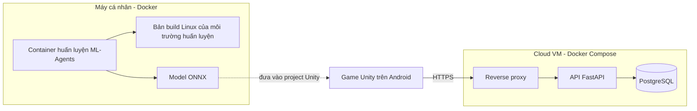

# Vượt Thác

Game đua thuyền 3D trên Android, làm cho đồ án cuối kỳ. Người chơi lái thuyền xuôi dòng sông qua ghềnh đá và thác nước, né đá, nhặt vật phẩm và đua với 5 thuyền AI. Thuyền đối thủ được huấn luyện bằng ML-Agents. Người chơi có thể đua cùng "bóng ma" của người giỏi nhất được tải về từ cloud.

> **Trạng thái 07/11/2026:** đã có bản lái Suối Rừng với 10 thuyền, vật lý nổi, camera, điều khiển cảm ứng/nghiêng máy và kết thúc lượt chạy. Chi tiết triển khai, kiểm tra và APK xem [PHASE1.md](PHASE1.md). AI, cloud, Docker và các chế độ mở rộng bên dưới vẫn là thiết kế dự kiến.

## Đáp ứng yêu cầu đồ án

| Yêu cầu | Cách đáp ứng | Trạng thái |
|---|---|---|
| **Unity** | Toàn bộ game 3D dùng URP: sông dựng theo spline, vật lý thuyền nổi, dòng chảy, thác | Đã có bản lái giai đoạn 1 |
| **AI** | AI trong game, không dùng LLM. Thuyền đối thủ học lái bằng ML-Agents (học tăng cường), chạy suy luận ngay trên điện thoại. Có thêm một AI dự phòng dùng FSM và đi theo spline | Chưa làm |
| **Cloud** | Backend trên cloud lưu và phát ghost của người chơi top, bảng xếp hạng theo từng đường đua, thử thách hằng ngày, lưu tiến độ | Chưa làm |
| **Docker** | Docker Compose đóng gói API, database và reverse proxy. Một container riêng chạy huấn luyện ML-Agents, cố định đúng phiên bản Python mà ML-Agents yêu cầu | Chưa làm |
| **Mobile** | Android màn hình ngang, nghiêng máy hoặc nút bấm để lái, giữ nút chèo | Đã triển khai điều khiển; xem kết quả build và thử thiết bị trong PHASE1.md |

## Cách chơi dự kiến

- **Điều khiển:** nghiêng điện thoại để bẻ lái. Thuyền tự trôi theo dòng, người chơi giữ nút để chèo nhanh hơn và chạm để dùng vật phẩm. Có thể đổi sang hai nút trái/phải nếu không thích nghiêng máy.
- **Va chạm:** va đá hoặc bờ thì thuyền mất tốc độ và bị đẩy lệch hướng. Thuyền không có thanh máu, nên mọi lỗi đều trả giá bằng thời gian.
- **Dòng chảy:** giữa dòng chảy nhanh nhưng nhiều đá, sát bờ an toàn hơn nhưng chậm. Thác là đoạn nhảy, phải vào đúng góc để không bị lật.
- **Vật phẩm:** tối đa giữ 1 vật phẩm.

| Vật phẩm | Tác dụng |
|---|---|
| Tăng tốc | Chèo cực nhanh trong 2 giây |
| Khiên | Va đá lần kế tiếp không bị mất tốc |
| Khúc gỗ | Thả ra phía sau, cản thuyền bám đuôi |

**Đường đua:** mỗi đường dài 1,5 đến 3 phút.

| Đường | Đặc điểm |
|---|---|
| 1. Suối Rừng | Nước êm, ít đá, để làm quen điều khiển |
| 2. Hẻm Đá | Nhiều đá, có nhánh rẽ: một nhánh ngắn nhưng hiểm, một nhánh dài nhưng an toàn |
| 3. Thác Lớn | Ghềnh, xoáy nước và 2 thác nhảy |

**Chế độ chơi:**

- **Cúp:** đua lần lượt 3 đường với 5 thuyền AI, cộng điểm theo thứ hạng.
- **Đua bóng ma:** đua một mình với ghost của người chơi top tải từ cloud.
- **Thử thách hằng ngày:** server chọn đường, mức nước và vị trí vật phẩm theo seed của ngày. Mọi người chơi cùng một điều kiện.

## AI trong game

Không dùng LLM. Toàn bộ AI chạy trên điện thoại nên game chơi được khi không có mạng và lúc demo luôn ổn định.

### Thuyền đối thủ học bằng ML-Agents

Thuyền AI không được lập trình sẵn đường đi mà tự học lái qua nhiều lần thử bằng thuật toán PPO.

- **Quan sát:** tia cảm biến (RayPerceptionSensor3D) phát hiện đá, bờ, thuyền khác và vật phẩm. Thêm vận tốc của thuyền, góc lệch so với hướng dòng sông, khoảng cách tới tâm dòng và hướng dòng chảy tại chỗ.
- **Hành động:** bẻ lái liên tục từ -1 đến 1, lực chèo từ 0 đến 1.
- **Phần thưởng:** cộng điểm theo quãng đường tiến được dọc sông và khi qua checkpoint, cộng lớn khi về đích. Trừ điểm khi va đá, va bờ, lật thuyền và theo mỗi bước thời gian trôi qua.
- **Học theo giai đoạn (curriculum):** đầu tiên là nước êm không có đá, sau đó thêm đá, cuối cùng thêm xoáy và thác.
- **Tăng tốc huấn luyện:** đặt 8 đến 16 bản sao đường đua trong cùng một scene để nhiều thuyền học song song.
- **Độ khó:** lấy model ở các mốc huấn luyện khác nhau. Model huấn luyện ít là mức Tập sự, model huấn luyện xong là mức Cao thủ.
- **Chạy trên điện thoại:** model xuất ra file ONNX, chạy bằng Inference Engine (trước đây gọi là Sentis) trên CPU. Thuyền ra quyết định 5 bước vật lý một lần cho nhẹ máy.

### AI dự phòng bằng FSM

AI này làm trước ML-Agents. Nó dùng để so sánh trong báo cáo, và làm đối thủ chính nếu huấn luyện không đạt.

- **Đi theo spline:** bám đường đua tối ưu được vẽ sẵn dọc sông.
- **FSM:** Đua → Né (tia raycast thấy đá phía trước) → Vượt (có thuyền chặn thì đổi làn) → Gỡ kẹt (đứng yên quá 2 giây thì lùi và xoay).
- **Dùng vật phẩm:** dùng tăng tốc ở đoạn thẳng, thả khúc gỗ khi có thuyền bám sát phía sau.
- **Rubber-banding:** thuyền bị bỏ xa thì được tăng nhẹ tốc độ để cuộc đua luôn sát nút.

### Hiển thị khi demo

- Bật chế độ debug để vẽ tia cảm biến, hành động của model và trạng thái FSM ngay trên màn hình.
- Cho 3 thuyền ở 3 mức huấn luyện chạy cùng lúc để thầy thấy AI giỏi lên theo thời gian huấn luyện.
- Chuẩn bị biểu đồ phần thưởng từ TensorBoard và video thuyền từ lúc lái loạng choạng đến lúc né đá thành thạo.

## Kiến trúc dự kiến



Docker không đóng gói game. Game vẫn chơi được khi mất mạng. Khi có mạng lại, game gửi kết quả và tải ghost cùng thử thách mới.

Container huấn luyện chỉ chạy trên máy cá nhân, không chạy trên cloud. Nó có hai lợi ích: ML-Agents đòi đúng một phiên bản Python nên container giữ môi trường cố định, và ai cũng chạy lại được việc huấn luyện bằng một lệnh. Nếu Docker trên Windows quá chậm khi huấn luyện, phương án dự phòng là chạy bằng môi trường ảo Python ngay trên máy.

**API dự kiến:**

| Endpoint | Việc |
|---|---|
| `POST /v1/runs` | Gửi thời gian về đích kèm đường đi đã ghi lại để làm ghost |
| `GET /v1/leaderboard?track=` | Bảng xếp hạng theo đường đua hoặc theo ngày |
| `GET /v1/ghosts/{id}` | Tải ghost để đua cùng |
| `GET /v1/daily-challenge` | Trả về đường đua, mức nước và seed vật phẩm của ngày |
| `GET /v1/save`, `PUT /v1/save` | Đọc và ghi tiến độ: đường đã mở, cúp đã đạt, thuyền đã mở khóa |
| `GET /health` | Kiểm tra server còn sống |

Ghost là vị trí và hướng của thuyền được ghi 10 lần mỗi giây rồi nén lại. Trước khi lưu, server kiểm tra các checkpoint có được qua đúng thứ tự không, tốc độ tối đa và thời gian về đích có hợp lý không, để chặn gian lận đơn giản.

## Công nghệ

| Thành phần | Phiên bản hoặc lựa chọn |
|---|---|
| Unity | 6000.5.9f1 |
| Render pipeline | URP 17.5.0 |
| Input | Input System 1.20.0, dùng cảm biến gia tốc để nghiêng máy |
| Đường đua | Splines package của Unity |
| AI | ML-Agents và Inference Engine. Phiên bản chốt khi cài, phải tương thích với Unity 6000.5 |
| Huấn luyện | Python theo đúng yêu cầu của ML-Agents, chạy trong Docker |
| Test | Unity Test Framework 1.7.0 |
| Android | API tối thiểu 26 |
| Asset 3D | Miễn phí, dự kiến thuyền, đá và cây low-poly từ Kenney, Quaternius và Poly Pizza |
| Backend | Dự kiến Python 3.12, FastAPI, PostgreSQL |
| Hạ tầng | Docker Compose, nhà cung cấp cloud chưa chốt |

## Hiệu năng trên điện thoại

- Mục tiêu 60 FPS trên máy Android tầm trung, tối thiểu 30 FPS.
- Nước dùng shader đơn giản: sóng tạo bằng đỉnh lưới và texture trôi theo dòng. Không mô phỏng chất lỏng thật.
- Thuyền nổi bằng 4 điểm phao tính lực đẩy, không dùng plugin vật lý nước.
- Tối đa 6 thuyền trên đường đua. Model AI nhỏ và ra quyết định mỗi 5 bước vật lý.
- Ánh sáng bake sẵn, chỉ một đèn real-time là mặt trời. Dùng sương mù và LOD để giới hạn tầm nhìn xa.
- Hiệu ứng bọt nước và vật phẩm dùng object pooling, không tạo mới liên tục.

## Cài đặt

**Cần có:**

- Unity Hub và Unity 6000.5.9f1, kèm module Android Build Support và Linux Build Support (để build môi trường huấn luyện)
- Git và Git LFS
- Docker Desktop (khi huấn luyện AI và khi làm backend)

**Tải và mở dự án:**

```bash
git lfs install
```

```bash
git clone <URL_REPO>
```

Sau đó mở thư mục vừa clone bằng Unity Hub, đúng phiên bản 6000.5.9f1. Lần mở đầu tiên Unity sẽ mất vài phút để tạo lại thư mục `Library`.

**Dựng map:** menu **Vượt Thác > Tạo scene Đường 1 - Suối Rừng** tạo scene, spline sông và dựng toàn bộ map. Muốn đổi map thì kéo các điểm của spline hoặc sửa thông số trên component `RiverTrack`, rồi bấm nút **Dựng lại địa hình, nước, đá và cây** trong Inspector.

**Dùng Unity MCP (không bắt buộc):** package MCP for Unity đã có trong project và file `.mcp.json` trỏ tới `http://127.0.0.1:8080/mcp`. Hãy khởi động server trong cửa sổ MCP for Unity của Unity Editor trước khi kết nối.

## Cấu trúc thư mục

```text
Assets/           Tài nguyên và code game. Code riêng của game đặt trong Assets/_Game
  _Game/Scenes      Mỗi đường đua một scene
  _Game/Generated   Mesh địa hình, nước, đá và cây do công cụ dựng sông tự sinh, không sửa tay
Packages/         Danh sách package của Unity
ProjectSettings/  Cài đặt project Unity
Training/         Cấu hình huấn luyện ML-Agents, Dockerfile và kết quả (sẽ thêm khi làm AI)
Backend/          API và Docker Compose (sẽ thêm khi làm backend)
```

## Quy trình làm việc

1. Làm một mình nên commit thẳng lên `main`, không dùng nhánh hay Pull Request.
2. Commit nhỏ, đặt tên theo dạng `feat: ...`, `fix: ...`, `docs: ...`, `test: ...`, `chore: ...`.
3. Trước khi commit:
   - Unity không còn lỗi biên dịch.
   - Các test liên quan đều đạt.
   - Tính năng đã được chạy thử trong Play Mode, và trên điện thoại nếu liên quan đến điều khiển hoặc hiệu năng.
4. Xong mỗi giai đoạn trong kế hoạch thì kiểm tra lại toàn bộ rồi mới push.
5. Kết quả huấn luyện lớn (thư mục `results`, checkpoint) không đưa lên Git, chỉ giữ file ONNX cuối cùng của từng mức độ khó.

## Kế hoạch

- [x] **Chuẩn bị:** README, Git
- [ ] **Giai đoạn 1 - Bản lái đầu tiên:** triển khai và APK đã xong, build Android 0 lỗi; đã có sông spline, thuyền nổi, dòng chảy, va chạm đá, camera và điều khiển nghiêng/cảm ứng. Còn xác nhận cảm giác lái trên điện thoại thật khi có thiết bị kết nối. Xem [PHASE1.md](PHASE1.md).
- [ ] **Giai đoạn 2 - AI dự phòng:** thuyền đi theo spline, FSM, né đá, checkpoint, xếp hạng trong cuộc đua, rubber-banding
- [ ] **Giai đoạn 3 - ML-Agents:** viết Agent, phần thưởng và curriculum, huấn luyện trong Docker, đưa model vào game, so sánh với AI dự phòng. Đặt mốc quyết định ở cuối giai đoạn này (xem phần Rủi ro)
- [ ] **Giai đoạn 4 - Bản chơi đầy đủ:** vật phẩm, 3 đường đua, thác, chế độ Cúp, giao diện, thắng thua
- [ ] **Giai đoạn 5 - Mobile:** tối ưu, hiệu chỉnh nghiêng máy, thử trên điện thoại thật
- [ ] **Giai đoạn 6 - Backend:** API dữ liệu giả, Docker Compose chạy trên máy
- [ ] **Giai đoạn 7 - Cloud:** deploy, HTTPS, ghost, bảng xếp hạng, thử thách hằng ngày, lưu tiến độ
- [ ] **Giai đoạn 8 - Báo cáo:** hoàn thiện, viết báo cáo, quay video demo dự phòng và video quá trình huấn luyện

### Phạm vi tối thiểu

Bản nộp phải có đủ 5 thành phần. Phần cốt lõi gồm:

- Lái thuyền bằng nghiêng máy, dòng chảy, va chạm đá, về đích.
- Thuyền AI đối thủ: model ML-Agents, hoặc AI dự phòng nếu huấn luyện không đạt.
- Đường 1 và đường 2.
- Bản APK chạy được trên điện thoại Android tầm trung.
- Backend chạy bằng Docker Compose trên cloud, có ghost và bảng xếp hạng.

Nếu trễ tiến độ, cắt theo thứ tự sau mà vẫn giữ được phần cốt lõi:

1. Đường 3 Thác Lớn.
2. Vật phẩm Khúc gỗ.
3. Thử thách hằng ngày.
4. Nhiều mức độ khó, chỉ giữ một model.
5. Lưu tiến độ lên cloud, chuyển sang lưu trên máy.

## Rủi ro

| Rủi ro | Cách xử lý |
|---|---|
| ML-Agents huấn luyện lâu mà thuyền vẫn không học được | Làm AI dự phòng trước. Nếu hết giai đoạn 3 mà model vẫn thua AI dự phòng, AI dự phòng thành đối thủ chính, còn model ML-Agents chỉ dùng cho một mức độ khó và để trình bày trong báo cáo |
| Cài ML-Agents bị lỗi phiên bản Python hoặc package | Dùng container huấn luyện, chốt phiên bản ngay từ đầu giai đoạn 3 |
| Nghiêng máy khó điều khiển | Hiệu chỉnh tư thế máy khi bắt đầu đua, thêm vùng chết và làm mượt, có lựa chọn đổi sang nút bấm |
| Hiệu ứng nước làm nặng máy | Shader đơn giản, kiểm tra FPS trên máy thật từ giai đoạn 1 |
| Thuyền bị lật hoặc kẹt vào bờ | Tự đưa thuyền về checkpoint gần nhất sau 3 giây |

## Bảo mật

- Không commit mật khẩu, khóa bí mật hay file `.env`. Khi có backend, các biến cần thiết sẽ được liệt kê trong `.env.example`.
- Không đưa bí mật của server vào code Unity hoặc APK.
- Không dán bí mật hay dữ liệu cá nhân thật vào prompt AI.

## Sử dụng AI

Dự án có dùng AI (Claude Code và Unity MCP) để hỗ trợ viết code và tài liệu. Người làm phải hiểu và giải thích được mọi phần đưa vào dự án. Commit nào có dùng AI sẽ ghi rõ trong nội dung commit.

## Thành viên

Kaito1412Hung, làm toàn bộ dự án. Cần bổ sung họ tên và mã số sinh viên.
