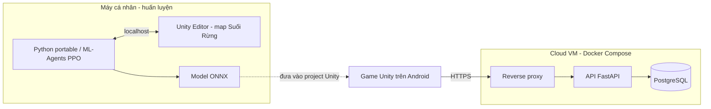

# Vượt Thác

Game đua thuyền 3D trên Android, làm cho đồ án cuối kỳ. Người chơi lái thuyền xuôi dòng sông qua ghềnh đá và thác nước, né đá và đua với 5 thuyền AI. Yêu cầu AI của đồ án là **mô hình mạng nơ-ron được huấn luyện**, không chỉ FSM. Giai đoạn 3 dùng ML-Agents/PPO, khởi tạo bằng dữ liệu chuyên gia từ FSM rồi học tăng cường. FSM giữ làm đối chứng và dự phòng kỹ thuật, không thay thế yêu cầu có model đã train. Vật phẩm và Cúp đã triển khai cho đấu máy; đua cùng "bóng ma" tải từ cloud thuộc giai đoạn sau.

**Phạm vi map:** game chỉ có **1 map chơi duy nhất — Suối Rừng**. Các nhánh sông, hang động, ghềnh và thác đều nằm trong map này. Các giai đoạn tiếp theo tiếp tục hoàn thiện gameplay trên Suối Rừng, không bổ sung map chơi khác.

> **Nền tảng gameplay:** bản Unity đã có 10 thuyền để chọn, 5 đối thủ FSM, đếm ngược xuất phát, checkpoint, thứ hạng và kết quả đua trên Suối Rừng. Chi tiết phần lái và APK cũ xem [PHASE1.md](PHASE1.md); triển khai và kiểm tra giai đoạn 2 xem [PHASE2.md](PHASE2.md). APK cũ chưa có các tính năng giai đoạn 2 trở về sau.

> **Bổ sung 08/11/2026:** đã thêm 5 độ khó đấu máy và triển khai phòng bạn bè qua Internet bằng mã, sẵn sàng và chủ phòng bắt đầu. Phòng 2 người tạo 2 thuyền, không thêm AI. Trạng thái kiểm tra, giới hạn dịch vụ và hướng dẫn xem [ONLINE.md](ONLINE.md). APK cũ chưa có các phần bổ sung này.

> **Giai đoạn 3 — đã triển khai và kiểm tra trong Unity Editor:** model BC/PPO được huấn luyện thực, ONNX đã tích hợp; chọn **AI: PPO / AI: FSM** tại màn chọn thuyền. Kiểm tra toàn tuyến đạt 6/6 thuyền ở cả 5 mức, và 6/6 khi đổi ngược làn xuất phát. PPO còn chậm hơn FSM, cần cân bằng thêm; Android chưa kiểm tra. Xem kết quả và giới hạn trong [PHASE3.md](PHASE3.md).

> **Giai đoạn 4 — đã triển khai và kiểm tra trong Unity Editor:** ba vật phẩm, kho một ô, HUD dùng bằng E/tay cầm/cảm ứng, Cúp 3 lượt cùng map, điểm tích lũy, kết quả/hết giờ/chơi lại và thành tích cục bộ. Kiểm tra luật/UI đạt 31/31; đua có vật phẩm đạt 6/6 về đích. Vật phẩm/Cúp chưa áp dụng cho phòng bạn bè; chưa kiểm tra Android. Xem [PHASE4.md](PHASE4.md).

> **Bổ sung mật độ và ngẫu nhiên:** tối đa 240 điểm nhặt, hồi sau 5 giây; mỗi lượt đấu máy/Cúp bốc mới vị trí/loại vật phẩm và bố cục đá/gỗ. Kiểm tra sinh bố cục đạt 24/24; ba lượt đua ngẫu nhiên đều 6/6 về đích.

> **Bổ sung đội máy:** bốc 5 loại từ cả 10 loại thuyền; model đã train thêm 80.028 bước với dữ liệu đủ 10 loại. Bốn nhóm kiểm tra bao phủ cả 10 loại đều 6/6 về đích; giao diện chơi lại đã xác nhận đổi đội. Số liệu kiểm tra 5 mức của giai đoạn 3 thuộc model V5 trước đó; model bổ sung hiện được kiểm tra ở mức Thường.

> **Giai đoạn 6 — đã chạy trên máy:** Backend trong Docker, game trong Unity Editor gửi kết quả, xem bảng xếp hạng, đua với bóng ma, chơi thử thách ngày và đồng bộ tiến độ. Bản phát hành chưa có địa chỉ server nên các tính năng này tự ẩn. Xem [PHASE6.md](PHASE6.md).

## Đáp ứng yêu cầu đồ án

| Yêu cầu | Cách đáp ứng | Trạng thái |
|---|---|---|
| **Unity** | Toàn bộ game 3D dùng URP: sông dựng theo spline, vật lý thuyền nổi, dòng chảy, thác | Đã có bản lái giai đoạn 1 |
| **AI** | Mạng nơ-ron học điều khiển qua ML-Agents/PPO, xuất ONNX chạy trong game; không dùng LLM. FSM là bản đối chứng để đo cải thiện, không phải model học máy | Model đã train và chạy trong Unity; xem PHASE3.md |
| **Cloud** | UGS Lobby/Relay phục vụ phòng bạn bè qua Internet. Backend riêng lưu ghost, bảng xếp hạng, thử thách hằng ngày và tiến độ vẫn là kế hoạch sau | Phòng UGS đã triển khai; backend riêng chưa làm |
| **Docker** | Docker Compose đóng gói API, database và reverse proxy; đã có Dockerfile trainer bổ sung | Backend chạy trên máy và game đã nối vào; xem [PHASE6.md](PHASE6.md). Dockerfile trainer chưa chạy kiểm tra |
| **Mobile** | Android màn hình ngang, nghiêng máy hoặc nút bấm để lái, giữ nút chèo | Đã triển khai điều khiển; xem kết quả build và thử thiết bị trong PHASE1.md |

## Cách chơi

- **Điều khiển:** nghiêng điện thoại để bẻ lái. Thuyền tự trôi theo dòng, người chơi giữ nút để chèo nhanh hơn. Nhấn E trên PC, X trên tay cầm hoặc chạm nút vật phẩm để dùng. Có thể đổi sang hai nút trái/phải nếu không thích nghiêng máy.
- **Va chạm:** va đá hoặc bờ thì thuyền mất tốc độ và bị đẩy lệch hướng. Thuyền không có thanh máu, nên mọi lỗi đều trả giá bằng thời gian.
- **Dòng chảy:** giữa dòng chảy nhanh nhưng nhiều đá, sát bờ an toàn hơn nhưng chậm. Thác là đoạn nhảy, phải vào đúng góc để không bị lật.
- **Vật phẩm:** tối đa giữ 1 vật phẩm; có trong đấu máy và Cúp, chưa dùng trong phòng bạn bè. Không dùng trước khi hết đếm ngược.
- **Bố cục từng lượt:** điểm vật phẩm xuất hiện dày theo cụm và hồi sau 5 giây; đá/gỗ trong đường đua thay đổi ngẫu nhiên khi chơi lại hoặc qua lượt Cúp, vẫn chừa lối qua và giữ các cửa nhánh/thác.
- **Đấu máy:** chọn một trong 5 mức Rất dễ, Dễ, Thường, Khó, Rất khó trước khi bắt đầu.
- **Đội thuyền máy:** mỗi trận đua một lượt bốc 5 loại từ danh sách 10 loại, không trùng loại giữa các máy. Mỗi Cúp bốc một đội rồi giữ qua 3 lượt để tính điểm; Cúp mới bốc lại. Người chơi vẫn tự chọn thuyền của mình.
- **Bạn bè:** tạo/vào phòng bằng mã qua Internet; từ 2 người sẵn sàng thì chủ phòng bắt đầu. Chỉ những người trong phòng đua cùng nhau, không thêm máy. Giới hạn và cách thử xem [ONLINE.md](ONLINE.md).

| Vật phẩm | Tác dụng |
|---|---|
| Tăng tốc | Chèo cực nhanh trong 2 giây |
| Khiên | Va đá lần kế tiếp không bị mất tốc |
| Khúc gỗ | Thả ra phía sau, cản thuyền bám đuôi |

**Map chơi duy nhất: Suối Rừng.** Đường đua có sông chính, các nhánh rẽ qua hang động, ghềnh đá và thác nước. Người chơi chọn lối đi trong cùng map; các nhánh không phải map hoặc màn chơi riêng. Thời gian hoàn thành tùy thuyền, lối đi và kỹ năng lái.

| Map | Đặc điểm |
|---|---|
| Suối Rừng | Sông chính và 3 nhánh sông, hang động, 3 thác trên đường đua, cảnh quan núi rừng và công trình ven sông |

**Chế độ:** chọn đua một lượt hoặc Cúp tại nút **CHẾ ĐỘ** trong màn chọn thuyền. Có thể chọn PPO hoặc FSM cho 5 đối thủ.

- **Cúp (đã triển khai):** 3 lượt trên Suối Rừng, cộng điểm 10/8/6/4/2/1 theo thứ hạng; chưa về đích được 0 điểm. Có bảng điểm và cúp vàng/bạc/đồng. Thời gian mỗi lượt tối đa 420 giây, các thuyền còn lại có 45 giây sau khi người chơi về đích.
- **Đua bóng ma (dự kiến):** đua một mình với ghost của người chơi top tải từ cloud.
- **Thử thách hằng ngày (dự kiến):** luôn dùng Suối Rừng; server chọn mức nước và vị trí vật phẩm theo seed của ngày. Mọi người chơi cùng một điều kiện.

## AI trong game

Không dùng LLM. Model suy luận trực tiếp trong Unity, không cần gọi dịch vụ AI qua Internet hoặc chạy Python khi chơi. Đã kiểm tra trong Editor; hiệu năng và độ ổn định trên điện thoại còn phải đo ở giai đoạn mobile.

### Thuyền đối thủ học bằng ML-Agents (giai đoạn 3)

Môi trường cung cấp các mục tiêu dẫn đường lấy từ spline và nhánh của Suối Rừng. Model học cách biến quan sát thành lệnh chèo/bẻ lái; không gọi FSM để quyết định hành động khi chạy suy luận. Đã dùng Behavioral Cloning từ dữ liệu FSM rồi tiếp tục huấn luyện bằng PPO. Đây là model tự huấn luyện cho game, không phải model có sẵn được đổi tên.

- **Quan sát:** 42 giá trị gồm các cảm biến SphereCast trước/hai bên, hướng mục tiêu ở nhiều khoảng nhìn trước, vận tốc, độ nghiêng, dòng chảy, độ lệch lộ trình và thông số thân thuyền. Vật phẩm chưa thuộc môi trường huấn luyện giai đoạn này.
- **Hành động:** bẻ lái và lực chèo đều liên tục từ -1 đến 1, có hãm/lùi.
- **Phần thưởng:** cộng theo quãng đường tiến dọc lộ trình và hoàn thành mục tiêu episode; trừ khi va chạm, cạ bờ, thất bại hoặc theo thời gian. Checkpoint được dùng khi đánh giá đua thật; môi trường train không tự cộng thưởng qua checkpoint.
- **Học theo giai đoạn (curriculum):** tăng chiều dài episode 90 → 180 → 400 m → toàn tuyến. Collider và chướng ngại của map giữ nguyên trong mọi bài tập.
- **Tăng tốc huấn luyện:** 8 thuyền học song song trên collider thật của Suối Rừng; tạm ẩn cảnh quan/nhân vật trong phiên train và bỏ va chạm giữa các thuyền đang học. Không tạo map chơi mới hoặc sửa cảnh quan đã duyệt.
- **Độ khó:** cùng model cho 5 mức, điều chỉnh lực chèo ở đoạn thẳng thông thoáng; giữ nhịp điều khiển đã học khi cua và vào nhánh. Đã kiểm tra về đích cả 5 mức, còn cần nhiều lượt để cân bằng độ khó.
- **Suy luận:** ONNX chạy bằng Inference Engine trên CPU; ra quyết định 5 bước vật lý một lần. Đã chạy trong Unity Editor, chưa kiểm tra bản Android có model mới.

### AI dự phòng bằng FSM (đã triển khai trong Unity)

AI này làm trước ML-Agents và dùng để so sánh trong báo cáo. Nếu model chưa đạt, FSM giúp bản chơi tiếp tục hoạt động nhưng không được coi là hoàn thành yêu cầu model AI. Xem cách chạy và kết quả tại [PHASE2.md](PHASE2.md).

- **Đi theo spline:** bám đường đua tối ưu được vẽ sẵn dọc sông.
- **FSM:** Đua → Né (cảm biến thấy vật cản) → Vượt (có thuyền chặn thì đổi hướng tránh) → Gỡ kẹt (không tiến theo lộ trình trong 2,5 giây thì lùi và xoay); sau nhiều lần thử không thành công, hồi phục về checkpoint đã qua.
- **Dùng vật phẩm:** đã có luật chọn thời điểm tăng tốc, bật khiên và thả gỗ ở giai đoạn 4. Đây là luật bổ sung cho cả PPO/FSM, chưa phải hành vi vật phẩm được model học.
- **Rubber-banding:** thuyền bị bỏ xa thì được tăng nhẹ tốc độ để cuộc đua luôn sát nút.

### Hiển thị khi demo

- Bật chế độ debug để vẽ tia cảm biến, hành động của model và trạng thái FSM ngay trên màn hình.
- Cho 3 thuyền ở 3 mức huấn luyện chạy cùng lúc để thầy thấy AI giỏi lên theo thời gian huấn luyện.
- Chuẩn bị biểu đồ phần thưởng từ TensorBoard và video thuyền từ lúc lái loạng choạng đến lúc né đá thành thạo.

## Kiến trúc dự kiến



Docker không đóng gói game. Game vẫn chơi được khi mất mạng. Khi có mạng lại, game gửi kết quả và tải ghost cùng thử thách mới.

Huấn luyện hiện chạy trên máy cá nhân bằng Python portable, với các phiên bản đã chốt trong `Training/requirements.lock.txt`. Dockerfile là cách đóng gói bổ sung, chưa được kiểm tra vì Docker daemon chưa chạy. Không cần trainer hoặc Python để suy luận model trong game.

**API** (đã làm, chi tiết trong [Backend/README.md](Backend/README.md)):

| Endpoint | Việc |
|---|---|
| `POST /v1/players` | Tạo tài khoản ẩn danh, trả về token |
| `POST /v1/runs` | Gửi thời gian về đích kèm đường đi đã ghi lại để làm ghost |
| `GET /v1/leaderboard?mode=` | Bảng xếp hạng Suối Rừng theo chế độ, thuyền hoặc ngày |
| `GET /v1/ghosts/{id}` | Tải ghost để đua cùng |
| `GET /v1/daily-challenge` | Trả về seed bố cục và độ khó của ngày trên Suối Rừng |
| `GET /v1/save`, `PUT /v1/save` | Đọc và ghi tiến độ: thành tích trên Suối Rừng, cúp đã đạt, thuyền đã mở khóa |
| `GET /health` | Kiểm tra server còn sống |

Ghost là vị trí và hướng của thuyền được ghi 10 lần mỗi giây rồi nén lại. Trước khi lưu, server kiểm tra các checkpoint có được qua đúng thứ tự không, tốc độ tối đa và thời gian về đích có hợp lý không, để chặn gian lận đơn giản.

## Công nghệ

| Thành phần | Phiên bản hoặc lựa chọn |
|---|---|
| Unity | 6000.5.9f1 |
| Render pipeline | URP 17.5.0 |
| Input | Input System 1.20.0, dùng cảm biến gia tốc để nghiêng máy |
| Đường đua | Splines package của Unity |
| AI | Unity ML-Agents 4.2.0 và Unity Inference Engine; PPO có dữ liệu chuyên gia để khởi tạo |
| Huấn luyện | Python portable 3.10.11, ML-Agents 1.1.0, PyTorch CPU 2.2.2; chạy trainer với Unity Editor. Docker có cấu hình bổ sung, chưa kiểm tra |
| Test | Unity Test Framework 1.7.0 |
| Android | API tối thiểu 26 |
| Asset 3D | Miễn phí, dự kiến thuyền, đá và cây low-poly từ Kenney, Quaternius và Poly Pizza |
| Backend | Python 3.12, FastAPI, PostgreSQL 17, Caddy |
| Hạ tầng | Docker Compose, nhà cung cấp cloud chưa chốt |

## Hiệu năng trên điện thoại

- Mục tiêu 60 FPS trên máy Android tầm trung, tối thiểu 30 FPS.
- Nước dùng shader đơn giản: sóng tạo bằng đỉnh lưới và texture trôi theo dòng. Không mô phỏng chất lỏng thật.
- Thuyền nổi bằng 4 điểm phao tính lực đẩy, không dùng plugin vật lý nước.
- Đấu máy có 6 thuyền; phòng bạn bè có số thuyền theo số người tham gia. Hiệu năng phòng đông cần đo trên thiết bị, không coi số chỗ tối đa của dịch vụ là số người điện thoại chắc chắn chạy được. Model AI ML-Agents nhỏ đã được train và kiểm tra trong Editor ở giai đoạn 3; còn đo trên điện thoại.
- Ánh sáng bake sẵn, chỉ một đèn real-time là mặt trời. Dùng sương mù và LOD để giới hạn tầm nhìn xa.
- Hiệu ứng bọt nước và vật phẩm dùng object pooling, không tạo mới liên tục.

## Cài đặt

**Cần có:**

- Unity Hub và Unity 6000.5.9f1, kèm module Android Build Support. Lượt train hiện tại kết nối trực tiếp Editor trên Windows, không bắt buộc Linux Build Support.
- Git và Git LFS
- Docker Desktop khi làm backend hoặc chọn huấn luyện trong container. Trainer hiện có thể chạy bằng Python portable trong `Training`.

**Tải và mở dự án:**

```bash
git lfs install
```

```bash
git clone <URL_REPO>
```

Sau đó mở thư mục vừa clone bằng Unity Hub, đúng phiên bản 6000.5.9f1. Lần mở đầu tiên Unity sẽ mất vài phút để tạo lại thư mục `Library`.

**Mở map hiện có:** mở scene `Assets/_Game/Scenes/Track01_SuoiRung.unity` rồi vào Play Mode. Đây là scene của map chơi duy nhất.

**Dựng lại map khi phát triển:** menu **Vượt Thác > Tạo scene Đường 1 - Suối Rừng** tạo scene, spline sông và dựng toàn bộ map. Tên menu/scene còn số 1 để giữ tương thích với project, không có nghĩa game có nhiều map. Khi cần chỉnh hình dạng Suối Rừng, sửa spline hoặc thông số `RiverTrack`, rồi dùng nút **Dựng lại địa hình, nước, đá và cây** trong Inspector; thao tác này sinh lại cảnh quan nên cần sao lưu các chỉnh sửa thủ công trước.

**Dùng Unity MCP (không bắt buộc):** package MCP for Unity đã có trong project và file `.mcp.json` trỏ tới `http://127.0.0.1:8080/mcp`. Hãy khởi động server trong cửa sổ MCP for Unity của Unity Editor trước khi kết nối.

## Cấu trúc thư mục

```text
Assets/           Tài nguyên và code game. Code riêng của game đặt trong Assets/_Game
  _Game/Scenes      Scene map chơi duy nhất: Track01_SuoiRung.unity
  _Game/Generated   Mesh địa hình, nước, đá và cây do công cụ dựng sông tự sinh, không sửa tay
Packages/         Danh sách package của Unity
ProjectSettings/  Cài đặt project Unity
Training/         Trainer portable, cấu hình PPO, dữ liệu mẫu, báo cáo và công cụ kiểm tra/đưa ONNX vào game
Backend/          API, database, Caddy và Docker Compose
```

## Quy trình làm việc

1. Làm một mình nên commit thẳng lên `main`, không dùng nhánh hay Pull Request.
2. Commit nhỏ, đặt tên theo dạng `feat: ...`, `fix: ...`, `docs: ...`, `test: ...`, `chore: ...`.
3. Trước khi commit:
   - Unity không còn lỗi biên dịch.
   - Các test liên quan đều đạt.
   - Tính năng đã được chạy thử trong Play Mode, và trên điện thoại nếu liên quan đến điều khiển hoặc hiệu năng.
4. Xong mỗi giai đoạn trong kế hoạch thì kiểm tra lại toàn bộ rồi mới push.
5. Kết quả huấn luyện lớn (thư mục `results`, checkpoint) không đưa lên Git, chỉ giữ file ONNX cuối cùng của từng mức độ khó.

## Kế hoạch

- [x] **Chuẩn bị:** README, Git
- [ ] **Giai đoạn 1 - Bản lái đầu tiên:** triển khai và APK đã xong, build Android 0 lỗi; đã có sông spline, thuyền nổi, dòng chảy, va chạm đá, camera và điều khiển nghiêng/cảm ứng. Còn xác nhận cảm giác lái trên điện thoại thật khi có thiết bị kết nối. Xem [PHASE1.md](PHASE1.md).
- [x] **Giai đoạn 2 - AI dự phòng:** đã triển khai trong Unity: 5 đối thủ theo spline/nhánh, FSM né đá/thuyền và gỡ kẹt, checkpoint, thứ hạng, kết quả và rubber-banding giới hạn. Đã kiểm tra 6/6 thuyền về đích và 7/7 luật đua trong Editor; còn chơi thử bằng tay và kiểm tra Android. Xem [PHASE2.md](PHASE2.md).
- [x] **Giai đoạn 3 - ML-Agents (Unity Editor):** đã train BC/PPO, xuất ONNX, tích hợp 5 đối thủ và nút chọn PPO/FSM; đủ 12 checkpoint, 6/6 thuyền về đích ở 5 mức và bài đổi làn. Có so sánh với FSM, kiểm tra miền hành động và thông tin nguồn model. Chưa kiểm tra Android; cần cân bằng thêm độ khó. Docker là cách chạy bổ sung, chưa kiểm tra. Xem [PHASE3.md](PHASE3.md).
- [x] **Giai đoạn 4 - Gameplay (Unity Editor):** ba vật phẩm, Cúp 3 lượt trên Suối Rừng, điểm tích lũy, HUD, thắng/thua/hết giờ, chơi lại, thành tích cục bộ. Luật/UI 31/31; đua có vật phẩm 6/6 về đích. Chưa kiểm tra Android hoặc triển khai vật phẩm/Cúp online. Xem [PHASE4.md](PHASE4.md).
- [ ] **Giai đoạn 5 - Mobile:** đã tối ưu cấp phát lặp, mesh/icon ở xa và cập nhật safe area; sửa ưu tiên cảm ứng, nhả điều khiển và cân bằng khi xoay màn hình. Đã build APK Android 0.5.0 thành công, 0 lỗi; chữ ký và căn chỉnh 16 KB đạt. Chờ thử điện thoại để đo hiệu năng/cảm giác lái. Xem [PHASE5.md](PHASE5.md).
- [x] **Giai đoạn 6 - Backend (trên máy):** API, PostgreSQL, Caddy và Docker Compose; game gửi kết quả, có bảng xếp hạng, đua với bóng ma, thử thách ngày, lưu tiến độ, tự gửi lại khi mất mạng. 46 test đạt và đã đua thật trong Unity Editor. Chưa kiểm tra Android. Xem [PHASE6.md](PHASE6.md).
- [ ] **Giai đoạn 7 - Cloud:** deploy, HTTPS, ghost, bảng xếp hạng, thử thách hằng ngày, lưu tiến độ
- [ ] **Giai đoạn 8 - Báo cáo:** hoàn thiện, viết báo cáo, quay video demo dự phòng và video quá trình huấn luyện

### Phạm vi tối thiểu

Bản nộp phải có đủ 5 thành phần. Phần cốt lõi gồm:

- Lái thuyền bằng nghiêng máy, dòng chảy, va chạm đá, về đích.
- Thuyền AI đối thủ có model đã huấn luyện chạy trong Unity; giữ FSM làm đối chứng và dự phòng, không dùng FSM thay cho tiêu chí model AI.
- Một map Suối Rừng hoàn chỉnh, gồm sông chính, nhánh rẽ, hang động và thác nước.
- Bản APK chạy được trên điện thoại Android tầm trung.
- Backend chạy bằng Docker Compose trên cloud, có ghost và bảng xếp hạng.

Nếu trễ tiến độ, cắt theo thứ tự sau mà vẫn giữ được phần cốt lõi:

1. Vật phẩm Khúc gỗ.
2. Thử thách hằng ngày.
3. Nhiều mức độ khó, chỉ giữ một model.
4. Lưu tiến độ lên cloud, chuyển sang lưu trên máy.

## Rủi ro

| Rủi ro | Cách xử lý |
|---|---|
| ML-Agents huấn luyện lâu mà thuyền vẫn không học được | Đo tỷ lệ hoàn thành, va chạm và thời gian so với FSM; điều chỉnh quan sát, phần thưởng và curriculum rồi train tiếp. FSM giữ game chạy được trong lúc phát triển, nhưng chưa nghiệm thu giai đoạn 3 nếu model chưa đạt tiêu chí |
| Cài ML-Agents bị lỗi phiên bản Python hoặc package | Dùng container huấn luyện, chốt phiên bản ngay từ đầu giai đoạn 3 |
| Nghiêng máy khó điều khiển | Hiệu chỉnh tư thế máy khi bắt đầu đua, thêm vùng chết và làm mượt, có lựa chọn đổi sang nút bấm |
| Hiệu ứng nước làm nặng máy | Shader đơn giản, kiểm tra FPS trên máy thật từ giai đoạn 1 |
| Thuyền bị lật hoặc kẹt vào bờ | Tự đưa thuyền về checkpoint gần nhất sau 3 giây |

## Bảo mật

- Không commit mật khẩu, khóa bí mật hay file `.env`. Khi có backend, các biến cần thiết sẽ được liệt kê trong `.env.example`.
- Không đưa bí mật của server vào code Unity hoặc APK.
- Không dán bí mật hay dữ liệu cá nhân thật vào prompt AI.

## Sử dụng AI

Dự án có dùng AI (Claude Code và Unity MCP) để hỗ trợ viết code và tài liệu. Người làm phải hiểu và giải thích được mọi phần đưa vào dự án. Commit nào có dùng AI sẽ ghi rõ trong nội dung commit.

## Thành viên

Kaito1412Hung, làm toàn bộ dự án. Cần bổ sung họ tên và mã số sinh viên.
